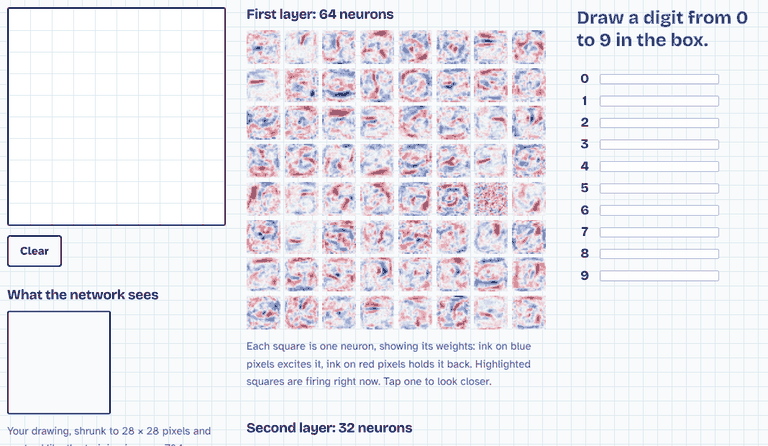
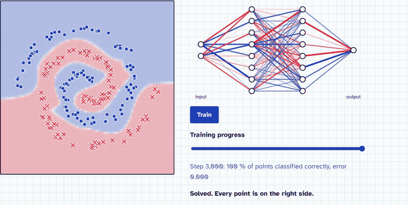

# Inside a Neural Network

An interactive website that shows what a neural network does and how it learns, built on
**scratchnet**, a small neural-network library written from scratch in NumPy. Everything the
page shows was trained with this library; the website itself only evaluates the trained
networks.

**Live demo:** <https://noahli472-ai.github.io/neural-network-explained/>



## What the page shows

1. **One neuron draws a line.** Three sliders for the weights and bias of a single neuron,
   and a replay of gradient descent moving the decision line into place.
2. **More neurons bend the line.** Four 2-D patterns (circle, checkerboard, moons, spiral)
   and three networks (1 neuron, 4 neurons, 8 + 8 neurons). The visitor replays the
   recorded training and sees the decision regions and the weights change.
3. **Read my handwriting.** Draw a digit with a finger or mouse. The page shows the 28 x 28
   input the network actually sees, the weights and activity of all 64 first-layer
   neurons, the 32 second-layer neurons, and the probability for each digit.



## Features

- **Neural-network library in NumPy** (`src/scratchnet/`): dense layers, ReLU, tanh and
  sigmoid, softmax cross-entropy, binary cross-entropy, SGD with momentum, Adam with
  decoupled weight decay, mini-batch training. Every backward pass is written by hand.
- **Gradient checking** of every layer, loss and whole networks against central finite
  differences.
- **MNIST pipeline:** download with SHA-256 verification, IDX reader, data augmentation
  (rotation, shear, aspect, stroke thickness) and MNIST-style normalisation of drawings.
- **Static website** (`web/`): plain HTML, CSS and JavaScript modules, no framework and no
  build step. Fonts are self-hosted, so the page loads nothing from third parties.
- **Python/JavaScript parity tests:** the JavaScript forward pass and preprocessing are
  checked against outputs written by the Python code.

## Method

**Neuron.** A neuron computes $\hat y = \sigma(w^\top x + b)$ with the logistic function
$\sigma(z) = 1/(1+e^{-z})$. Its decision boundary $w^\top x + b = 0$ is a straight line in
2-D, which is why one neuron cannot separate the circle, checkerboard, moons or spiral.

**Training.** Parameters $\theta$ minimise a loss $L$ by gradient descent,
$\theta \leftarrow \theta - \eta \nabla_\theta L$ (or with momentum / Adam). Backpropagation
applies the chain rule layer by layer. For a dense layer $y = xW + b$ with upstream gradient
$G = \partial L / \partial y$:

$$
\frac{\partial L}{\partial W} = x^\top G, \qquad
\frac{\partial L}{\partial b} = \textstyle\sum_n G_n, \qquad
\frac{\partial L}{\partial x} = G W^\top .
$$

Combining the output non-linearity with the loss gives the gradient
$\partial L / \partial z = (p - y)/N$ for both softmax cross-entropy and sigmoid binary
cross-entropy (`src/scratchnet/losses.py`).

**Station 1 and 2 data.** `scratchnet.playground` trains every dataset/network pair with
full-batch updates and stores the parameters at about 50 logarithmically spaced steps
(dense at the start, where the boundary changes fastest). The page replays these frames
and evaluates the network on a grid in the browser.

**Digit model.** A 784-64-32-10 ReLU network (52,650 parameters), trained for 16 epochs
with Adam (learning rate 2e-3, halved after 50 % and 75 % of the epochs, decoupled weight
decay 0.05) on augmented MNIST digits. Every augmented image goes through the same
normalisation as a drawing on the website: crop to the ink, scale the longer side to
20 px, centre the centre of mass in a 28 x 28 field.

| Metric (official MNIST test set, 10,000 images) | Value |
|---|---|
| Accuracy on the original test images | 97.05 % |
| Accuracy after the website's preprocessing | 97.59 % |

Both numbers come from `web/data/digits.json`, written by the training script, and are
re-checked in CI.

**Limitations.** The digit model is a multilayer perceptron, not a convolutional network,
so it is less robust to shifts and distortions than a CNN. Finger drawings differ from the
scanned pen strokes in MNIST; a continental 1 with a long upstroke, for example, can be
read as a 7. Stations 1 and 2 replay recorded training runs instead of training live.

## Installation

Requires Python 3.10 or newer.

```bash
git clone https://github.com/noahli472-ai/neural-network-explained.git
cd neural-network-explained
python -m venv .venv
source .venv/bin/activate          # Windows: .venv\Scripts\activate
pip install -e ".[dev]"
```

Step-by-step instructions for Windows and VS Code: [docs/RUNNING_IN_VSCODE.md](docs/RUNNING_IN_VSCODE.md).

## Usage

**Open the website locally** (the page loads its data with `fetch`, so it needs a server):

```bash
python -m http.server --directory web
```

Then open <http://localhost:8000>.

**Examples:**

```bash
python examples/quickstart.py         # gradient check, one neuron vs. a deeper network
python examples/classify_drawing.py   # classify a synthetic drawing with the shipped model
```

**Rebuild the website data:**

```bash
python scripts/build_playground.py    # stations 1 and 2, a few seconds
python scripts/train_digits.py        # station 3, downloads MNIST (~11 MB) on first run
python scripts/make_fixtures.py       # refresh the parity fixtures after retraining
```

Training the digit model took about 3 minutes on a 2-core cloud CPU.

**Publish on GitHub Pages:** in the repository settings, set *Pages → Source* to
*GitHub Actions*. The workflow `.github/workflows/pages.yml` then deploys `web/` on every
push to `main`.

## Tests

```bash
pytest          # Python: gradients, optimisers, preprocessing, shipped data files
npm test        # JavaScript: forward pass and preprocessing match Python (Node 22)
ruff check .    # linting
```

What the tests check, among other things:

- every layer, loss and complete networks against finite differences (relative error < 1e-6)
- a single neuron cannot learn XOR, one hidden layer can
- SGD, momentum and Adam reach the minimum of a quadratic; Adam's first step has size $\eta$
- the area-averaging resize preserves mean intensity; preprocessing is invariant to where
  the digit is drawn
- the recorded training runs tell the story the website tells (one neuron fails on every
  curved pattern, 8 + 8 neurons solve all of them, 4 neurons are not enough for the spiral)
- the shipped digit model reaches its recorded accuracy on the MNIST test set (marked
  `slow`; runs when MNIST is downloaded, and always in CI)

CI (`.github/workflows/ci.yml`) runs ruff, pytest on Python 3.10–3.12, the JavaScript tests
and the MNIST accuracy check on every push.

## Project structure

```
neural-network-explained/
├── src/scratchnet/
│   ├── layers.py          # Dense, ReLU, Tanh, Sigmoid with backward passes
│   ├── losses.py          # softmax cross-entropy, binary cross-entropy
│   ├── network.py         # Sequential container, mlp() builder
│   ├── optim.py           # SGD (momentum), Adam (weight decay)
│   ├── training.py        # mini-batch loop, accuracy
│   ├── gradcheck.py       # finite-difference gradients
│   ├── datasets.py        # 2-D toy datasets
│   ├── mnist.py           # download + IDX reader
│   ├── preprocessing.py   # MNIST-style normalisation of drawings
│   ├── augment.py         # data augmentation (SciPy)
│   ├── playground.py      # records training runs for stations 1 and 2
│   ├── digits.py          # trains the digit model
│   └── export.py          # JSON export for the website
├── web/                   # the website (deployed to GitHub Pages)
│   ├── index.html
│   ├── css/style.css
│   ├── js/                # nn.js (forward pass), preprocess.js, one module per station
│   ├── data/              # playground.json, digits.json (generated)
│   └── fonts/             # self-hosted fonts + licences
├── scripts/               # build_playground.py, train_digits.py, make_fixtures.py
├── examples/
├── tests/                 # pytest suite, tests/js (Node), tests/fixtures
└── docs/                  # screenshots, VS Code guide, code walkthrough
```

## Credits

- Code, website and trained models: Noah Lindner, 2026. MIT licence (see `LICENSE`).
- **MNIST** handwritten digits: Yann LeCun, Corinna Cortes and Christopher J. C. Burges.
  MNIST is not part of this repository; `scratchnet.mnist` downloads the original files
  from public mirrors and verifies their checksums. It is commonly distributed under
  CC BY-SA 3.0. The weights in `web/data/digits.json` were trained on it.
- **Fonts:** Bricolage Grotesque (The Bricolage Grotesque Project Authors) and Atkinson
  Hyperlegible (Braille Institute of America), both under the SIL Open Font License 1.1.
  Licence texts are in `web/fonts/`.
- The 2-D playground follows the idea of Google's
  [TensorFlow Playground](https://playground.tensorflow.org); no code was taken from it.
